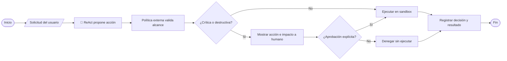

# Trabajo final — Arquitectura de IA, ML y gobernanza

Resolución profesional y humanizada de los tres ejercicios. Incluye diagramas de flujo con símbolos convencionales: óvalo para inicio o fin, paralelogramo para entrada o salida, rectángulo para proceso y rombo para decisión. El icono 🧠 identifica al LLM u orquestador; no representa un control de seguridad.

El dataset y los ejemplos del simulador son didácticos. No constituyen asesoramiento fiscal, certificación ISO ni un sistema productivo.

## Ejercicio 1 — ClimaAI: drift y métricas

El problema es de aprendizaje supervisado, modalidad regresión: el objetivo es estimar una magnitud continua, el consumo diario en kWh. Cada ejemplo de entrenamiento debe contener variables de entrada (temperatura, estación, características del hogar y hábitos) y el consumo real observado como etiqueta. El modelo aprende una relación entrada-salida minimizando el error contra esas etiquetas. No es clustering no supervisado ni aprendizaje por refuerzo.

El fallo se explica por deriva de datos estacional. En invierno, las entradas pueden quedar fuera de la distribución de verano; cambia la distribución de features (covariate shift) y, si cambia además la relación con el consumo por la calefacción, también hay concept drift. No hace falta que cambie el código para que caiga el rendimiento.

Respuesta de ciclo de vida: monitorear distribuciones y calidad de entradas por estación; incorporar y etiquetar consumos reales de invierno y verano; mantener un conjunto representativo; reentrenar o recalibrar el mismo tipo de algoritmo; validar con una partición temporal no vista antes del despliegue. Monitorear métricas solo cuando se recibe el consumo real asociado a la predicción.

MAE informa el error absoluto medio en kWh y es fácil de explicar. RMSE también está en kWh, pero penaliza más los errores grandes: es útil para detectar las fallas drásticas del caso. R² resume variabilidad explicada, pero no expresa el tamaño del error en kWh y puede ser negativo. Recomendación: usar MAE y RMSE como métricas operativas principales, segmentadas por estación; agregar R² como complemento. Si RMSE es mucho mayor que MAE, revisar valores extremos y segmentos afectados.

```mermaid
flowchart LR
 A([Inicio]) --> B[/Entradas y estación/]
 B --> C[Modelo supervisado de regresión]
 C --> D[/Consumo estimado en kWh/]
 E[/Consumo real medido/ --> F[MAE, RMSE y R²]
 D --> F --> G{¿Deriva o error alto?}
 G -- No --> H[Seguir monitoreando]
 G -- Sí --> I[Validar datos estacionales]
 I --> J[Actualizar dataset y entrenar]
 J --> K{¿Pasa validación temporal?}
 K -- Sí --> L[Desplegar versión validada]
 K -- No --> M[Investigar y conservar versión estable]
```

## Ejercicio 2 — TaxAgent: memoria y RAG

Falló la memoria o estado conversacional: el agente no recuperaba el historial de la sesión. La ventana de contexto no es una memoria persistente. Inyectar el manual completo de 5.000 páginas aumenta tokens y ruido, pero no conserva automáticamente turnos previos.

Solución de memoria: generar un session_id y guardar los turnos en almacenamiento persistente. En cada respuesta recuperar solo los turnos recientes relevantes y un resumen acumulativo de hechos, decisiones y pendientes. Separar memoria conversacional del índice documental, fijar retención y permisos, y habilitar eliminación según la política de privacidad. En el prompt entra contexto acotado, no el historial entero.

El pipeline RAG tiene tres pasos. Ingesta e indexación: extraer texto y metadatos del PDF, conservar título, página y vigencia, limpiar, dividir por secciones en fragmentos con solapamiento razonable, generar embeddings e indexarlos en un motor vectorial o híbrido. Recuperación: convertir la consulta en búsqueda, aplicar filtros de jurisdicción y fecha, seleccionar pocos fragmentos pertinentes y conservar referencias. Generación aumentada: combinar instrucciones, pregunta, memoria resumida y fragmentos recuperados; pedir una respuesta acotada con citas y abstención cuando las fuentes no alcancen. El tamaño de chunk y top-k se ajustan con pruebas, no son números universales.

```mermaid
flowchart LR
 subgraph Antes
 U[Pregunta] --> P[Prompt con PDF entero]
 P --> L[🧠 LLM]
 L --> R[Muchos tokens y poca memoria]
 end
 subgraph RAG
 D[/Manual PDF/ --> X[Extraer, limpiar, fragmentar]
 X --> E[Embeddings e índice con páginas]
 Q[/Pregunta y session_id/] --> V[Recuperar pasajes relevantes]
 E --> V
 M[Últimos turnos y resumen] --> O[🧠 Orquestador crea contexto acotado]
 V --> O --> G[🧠 LLM responde con citas]
 G --> A[/Respuesta y fuentes/]
 end
```

## Ejercicio 3 — GlobalDeliver: HITL y auditoría

Las instrucciones del usuario, incluso una supuesta alerta, son datos no confiables y no deben sustituir políticas. ReAct puede proponer acciones, pero las herramientas destructivas se controlan fuera del LLM con permisos mínimos, lista permitida, sandbox, validación de ruta y argumentos, vista previa del impacto y aprobación humana autenticada. Sin aprobación, ante timeout o duda, denegar y registrar; la persona decide sobre la propuesta concreta. HITL reduce el riesgo, pero no reemplaza controles técnicos.



ISO/IEC 42001 define requisitos para un sistema de gestión de IA: responsabilidades, evaluación y tratamiento de riesgos, controles, seguimiento y mejora continua. La trazabilidad permite reconstruir quién solicitó qué acción, qué herramienta se invocó, cuál fue la decisión y si hubo aprobación; facilita auditoría e investigación. La norma no impone este esquema JSON específico: es un ejemplo de registro que debe protegerse contra alteración y minimizar datos personales.

```json
{
  "session_id": "gd-2026-0042",
  "timestamp_utc": "2026-10-24T14:32:10Z",
  "tool": "filesystem.delete",
  "action": "propuesta: borrar /srv/ordenes/activas",
  "decision": "denegada_por_politica",
  "human_approval": {"required": true, "status": "rechazada", "actor_id": "operador-17"},
  "result": "no_ejecutada",
  "reason": "alcance destructivo; prompt injection no es autorización"
}
```

## Referencia del curso
Se tomó como apoyo el repositorio [gabrielsemiz-a11y/clases](https://github.com/gabrielsemiz-a11y/clases): Módulo 1 (paradigmas de ML, sesgos, privacidad y gobernanza, conceptos LLM), Módulo 2 (pipeline, regresión y baselines) y Módulo 5 (demo RAG en rag_demo.ipynb). Esta resolución es educativa y no una auditoría de conformidad ISO.
